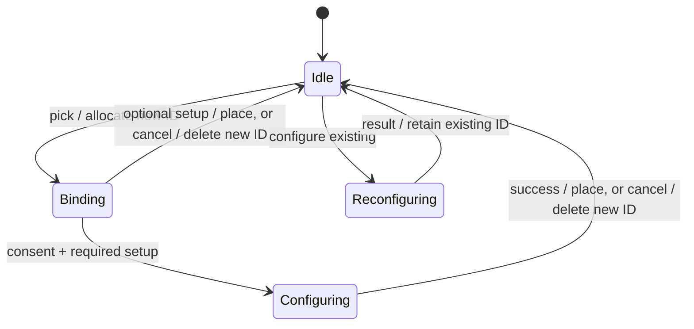

# State machines and transition ownership

This inventory groups stateful behavior by workflow across the Kotlin application sources. A machine can be implicit in booleans, nullable values, jobs, callbacks, timers or lifecycle observers; a single setting or derived display value does not need its own reducer. This is a source audit, not proof that every possible Android event ordering has been exercised.

## Decisions in this local experiment

Keep the existing appearance, persistence schemas, page geometry and native widget bindings. Make risky multi-step transitions explicit where the change is small enough to test. Preserve existing pure domain models rather than adding a global state-machine framework.

| Workflow | Owner / state and events | Decision and invariant |
| --- | --- | --- |
| Foreground navigation | `ui/HomeScreen.kt`, `ui/HomeNavigation.kt`: Home, Settings, Widgets, Pages, Weather, Wallpaper; open/dismiss/system Home/Settings intent | **Refactored.** One foreground surface; only Wallpaper and Pages have a Settings return path. Wallpaper may display Settings underneath. Replacement item belongs only to Widgets. |
| Transient home interactions | `ui/HomeScreen.kt`: editing, Add apps/destination, quick menu/stack selection, folder, resize, drag | **Centralized external reset.** Home and Settings entry points clear the same transient state; Home also clears query/request and selects the default page. Previously wallpaper/replacement state was omitted from these reset lists. |
| Selected page and restoration | `LauncherViewModel.kt`: saved page ID plus current layout/default | Retained. Validate IDs against current pages; Hub/Library are special IDs; deleted page falls back to default. |
| Pager navigation ownership | `ui/Workspace.kt`: navigating, userPaging, handledHomeRequest, previousCount, settled page | Retained. Programmatic motion must not be overwritten by a transient pager position. Observe settled states, preserve page identity through folding, and wait for the default-page flow on Home. |
| Library search and focus | `ui/AllAppsDrawer.kt`, `ui/HomeScreen.kt`: browse mode/category, query, focused, active, request/ack token | Retained. Recent apps require empty focused search. Offscreen pages must not consume Back; focus/IME request waits for settling. Focus is an Android effect, not durable storage. Moving a root-tracked result clears query/IME and reveals the last valid home page without losing the drag. |
| Contacts search | `ui/HomeScreen.kt`, `data/GlobalSearch.kt`: opt-in, permission, query, async matches | Retained. Query results depend on both preference and current permission; resume rechecks permission. No permission bypass. |
| Add-app destination | `ui/HomeScreen.kt`, `ui/AllAppsDrawer.kt`: open, Home/Dock target, selected pins | Retained; reset with external navigation. Six-favorite capacity and grid placement remain in domain/persistence code. |
| Quick actions and stack choice | `ui/HomeScreen.kt`, `ui/QuickOptions.kt`: selected item/anchor, published shortcuts, choosingStack, shown | Retained. Re-resolve item IDs against current layout; geometry changes close quick actions. Menu animation state is local to its composition. |
| Folder editing | `ui/FolderPanel.kt`: opened/entered, managing, renaming/title draft, query | Title tap enters rename independently of app selection; completion/focus loss/dismissal saves the draft. + toggles membership selection; A–Z orders current persisted members. Animation teardown and durable contents have different owners. Folder IDs scope saved editor state. |
| Drag pickup, hold, drop, cancel | `ui/AppTile.kt`, `ui/WidgetDragGesture.kt`: nullable DragSession, movement threshold, native touch ownership | **Hardened.** Consume the session before invoking hold/drop effects. Completion is at most once; reentrant callbacks may start a new session; an exception cannot leave the old drag active. Inline Library tiles transfer pointer tracking to the Home root, so removal of search results cannot cancel the handoff. Only root release/cancel ends that session. |
| Drag hover/reflow and edge paging | `ui/HomeScreen.kt`, `ui/Workspace.kt`: target, preview layout, edge direction/delay | Retained. Hover is a preview; only drop persists. App/folder grouping targets stay stationary; app-on-app release creates a folder. Other collisions retain reflow. Rotation/Home cancel dragging; page-edge timer is cancelled/restarted with keys. |
| Widget resizing | `ui/HomeMenus.kt`: active handle, live spans/origin, persisted item | Retained. Local gesture feedback is immediate; persist only valid grid/provider dimensions. Hysteresis prevents threshold flutter. Existing resize tests remain required. |
| Widget binding/setup | `widgets/WidgetController.kt`, `widgets/WidgetSetupFlow.kt`: Idle → Binding → Configuring → Idle, or Idle → Reconfiguring → Idle | **Refactored.** Only one transaction may run. An existing widget never becomes a disposable pending binding. Preserve page/replacement target across activity recreation. Consume a terminal transition before invoking callbacks. |
| Widget placement/repair persistence | `LauncherViewModel.kt`, `data/HomeLayout.kt`: newly bound ID → persisted placement/replacement or release | Retained. Controller owns binding/configuration; ViewModel owns persistence. Delete failed new IDs; delete old replacement ID only after successful save. Preserve other widget IDs. |
| Widget host subscription | `widgets/WidgetController.kt`: stopped, delayed start, listening | Retained. Remove delayed callbacks at stop; start only when STARTED. Listener delivery stays deferred for the first return-to-Home frame. |
| Native widget touch transfer | `widgets/LauncherWidgetHostView.kt`, `ui/WidgetDragGesture.kt`: provider stream → launcher-owned stream → new DOWN | Retained. Send ACTION_CANCEL once; suppress provider click until a fresh stream. Keep native scrolling before pickup. |
| Widget geometry publication | `widgets/LauncherWidgetHostView.kt`: attached/measured, pending publish, last signature | Retained. Publish only valid attached geometry, deduplicate sizes, and remove callbacks on detach. |
| Widget catalog loading | `ui/WidgetPickerScreen.kt`: null/loading → providers or failed; query/expanded group | Retained. Android provider/profile identity differs from display labels. Loading and consent do not allocate IDs until a provider is picked. |
| Orphan widget notification | `LauncherViewModel.kt`, `ui/HomeScreen.kt`: bindings invalid, grace timer, visible, dismissed/timeout | Retained. Never prune layout because a provider is temporarily unavailable. Session notice visibility is separate from repair. |
| Page editing and undo | `LauncherViewModel.kt`, `data/HomeLayout.kt`, `ui/PageManagerScreen.kt`: before/after layout, token, notice, Undo | Retained. Undo is guarded by the expected after-layout; reject unsafe restoration over newer edits. Snackbar visibility waits for full-page dismissal. |
| Preference initialization/migration | `data/LauncherPreferences.kt`, `data/HomeLayoutCodec.kt`: uninitialized, legacy/valid/corrupt layout, initialized | Retained. DataStore edits serialize persistence; corrupt/unsupported layouts fail closed. No schema changes in this experiment. |
| Backup export/restore | `ui/LauncherSettings.kt`, `LauncherViewModel.kt`, `data/BackupCodec.kt`: file selection, pending confirmation, IO/decode, atomic restore/result | Retained. Confirmation precedes restore; validate payload before writing. Keep widget restoration limitations visible. |
| Onboarding/tour | `ui/OnboardingScreen.kt`, `LauncherActivity.kt`: completed preference, five-page pager, privacy overlay, resume trigger | Retained. Tour is distinct from first-run completion; Back moves a step or exits as specified. Permission changes refresh on resume. |
| Permissions, role and external settings | `LauncherActivity.kt`, `ui/OnboardingScreen.kt`, `ui/LauncherSettings.kt`: unavailable/denied/granted, request, callback/resume | Retained. OS owns permission truth. Request on explicit feature actions; denial keeps manual alternatives available. |
| Weather polling/cache | `LauncherViewModel.kt`, `data/WeatherRepository.kt`: no location/loading/reading/error, subscription, cache age, refresh timer | Retained. Location changes cancel the previous collector; polling is subscription-scoped. See follow-up risks below. |
| Weather location search/detection | `ui/LauncherSettings.kt`, `LauncherViewModel.kt`, `data/WeatherRepository.kt`: query debounce/searching/results/error, detecting/permission/result | Retained for a dedicated async-work pass; search, GPS and preference writes have different cancellation and ownership semantics. |
| Wallpaper editing/apply | `ui/WallpaperPickerSheet.kt`: selection/title, processing, setting, target, external picker | Retained. Busy gate prevents parallel bitmap work; cancellation propagates; decode bounds protect memory. System wallpaper changes need device validation. |
| Animated sheets | `ui/FolderPanel.kt`, `ui/WeatherPickerSheet.kt`, `ui/HomeOptionsDock.kt`, `ui/QuickOptions.kt`: entering/open/exiting/dismissed | Retained. Local animation flags are appropriate; do not persist half-finished animations. |
| Settings dialogs and color draft | `ui/LauncherSettings.kt`, `ui/SettingsComponents.kt`: tour/privacy/about, picker, HSV/hex draft/validation/apply | Retained. Draft color and persisted color are intentionally distinct; validation precedes apply. |
| Fold/display tracking | `duo/FoldStateTracker.kt`, `duo/FoldState.kt`: registrations, sensor/feature/metrics evidence, posture, closing timestamps | Retained. Evidence determines surface; transient zero metrics must not blank the grid. Do not infer posture solely from orientation. |
| Cover handoff/wake recovery | `LauncherActivity.kt`: fold closing, pause/stop/resume, wake lock, retry/release timers | Retained. Hardware/OEM behavior requires physical fold tests; preserve bounded wake-lock lifetime and teardown. |
| Fold animation scheduling | `transition/TransitionDynamics.kt`, `transition/DuoUnfoldTransition.kt`: target/strength/deadline, blocked, scheduled/paused | Already explicit in the pure dynamics model. Retained. Reduced motion and interaction reset visuals; stop scheduling when settled. |
| Status and wallpaper telemetry | `duo/StatusMonitor.kt`, `duo/WallpaperToneTracker.kt`, `duo/NotificationDots.kt`: active subscriptions, registrations/access, latest data | Retained. Permission and lifecycle gate listeners. Foreground contrast and notification presence are derived outputs. |
| App discovery and launch recovery | `data/AppRepository.kt`: refresh job, loaded/apps, package events, launch unavailable | Retained. Snapshot freshness and cancellation deserve targeted follow-up, rather than a presentation rewrite. |
| Install sessions/new/recent apps | `data/Installs.kt`, `data/RecentApps.kt`: session progress/finish, new/opened/expired, recorded recents | Retained. Platform installer events own progress; local recency and new markers have separate persistence/expiry. |
| Stack selection and local rendering | `ui/Workspace.kt`, `data/HomeLayout.kt`: saved child index, members, unstack/remove | Retained. Structural edits preserve real IDs; visible child index is presentation state scoped to item identity. |

## Transition contracts for the refactored paths

`WidgetSetupFlow` produces ownership decisions, not Android side effects. `WidgetController` launches activities, checks provider availability, saves/restores phase and IDs, and runs effects. `LauncherViewModel` persists placement. Widget host ID and configuration request code stay unchanged. The new phase key supplements existing Bundle keys; legacy restored instances are recognized separately.

`HomeNavigation` is immutable and saveable through the host's saver. All full-page decisions derive from it, including blur/system-bar notification. System Home resets to `HOME`; system Settings resets to `SETTINGS`; both cancel transient interaction state. Opening the widget picker normally cannot inherit an old replacement target. Pages selected from Settings exit to Home, while dismissing Pages returns to Settings. Wallpaper dismissal preserves its original Settings return behavior.

## Remaining risks and useful follow-ups

These are source-level risks, not failures reproduced by this change:

- Automatic weather detection can be started by several lifecycle/permission paths. A future pass should use one owned request and ensure an older automatic result cannot replace a newer manual city selection. Weather search and detection also currently share an error field.
- `AppRepository.refresh()` cancels its previous job, but synchronous package-manager work does not itself suspend. A future pass should enforce cancellation before publishing to prevent an older snapshot winning a race.
- Backup operations use broad exception handlers. Cancellation should remain distinct from invalid input or IO failure, with a defined UI busy/result state before adding more restore behavior.
- `moveToDock`/`moveToGrid` perform ordered persistence steps. That avoids losing a placement on a full destination, but it is not one DataStore transaction across dock and grid. Preserve both surfaces on errors when considering an atomic transfer API.
- Snackbar tokens identify notices, while Undo is stored separately. A future concurrent-page-edit test should bind undo actions to the notice token rather than relying on timing.
- Full Android result payload correlation, OEM configuration activities, process recreation, IME focus and fold handoff need device instrumentation. Pure transition tests do not establish those runtime behaviors.

## Guide for developers and coding agents

1. Choose the owner in the inventory before adding a flag or launching work. Keep durable layout/preferences separate from transient navigation and platform-owned state.
2. Define legal states, events, effects, cancellation and restore behavior. Use explicit state for mutually exclusive operations; keep independent dimensions independent.
3. Consume terminal states before callbacks. Only the owner may release newly allocated resources. Never delete an existing widget because its settings were cancelled.
4. Test transition sequences, failure/cancel/duplicate paths, and preserved identity. Keep Android effect tests separate from pure JVM policy tests.
5. Run unit tests, lint, debug build and instrumentation compilation. Physically test the affected OS/provider interactions before claiming full device validation.

## Validation of this experiment

The added regression tests cover navigation return paths and invariants, widget transaction exclusivity/ownership/restored state, and drag completion/cancellation/reentrancy. See `TESTING.md` for exact results and the manual device matrix. Changes are local and are not authorization to commit or push.
